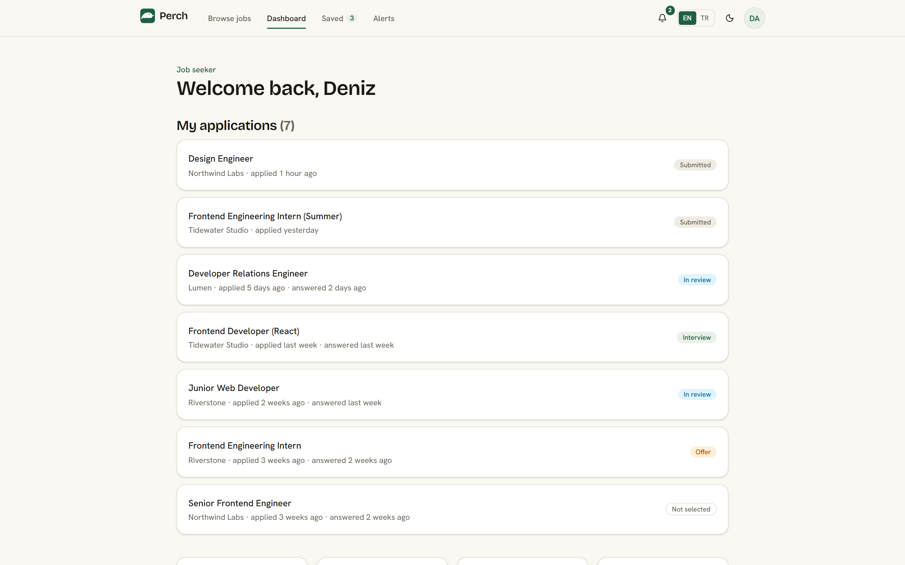
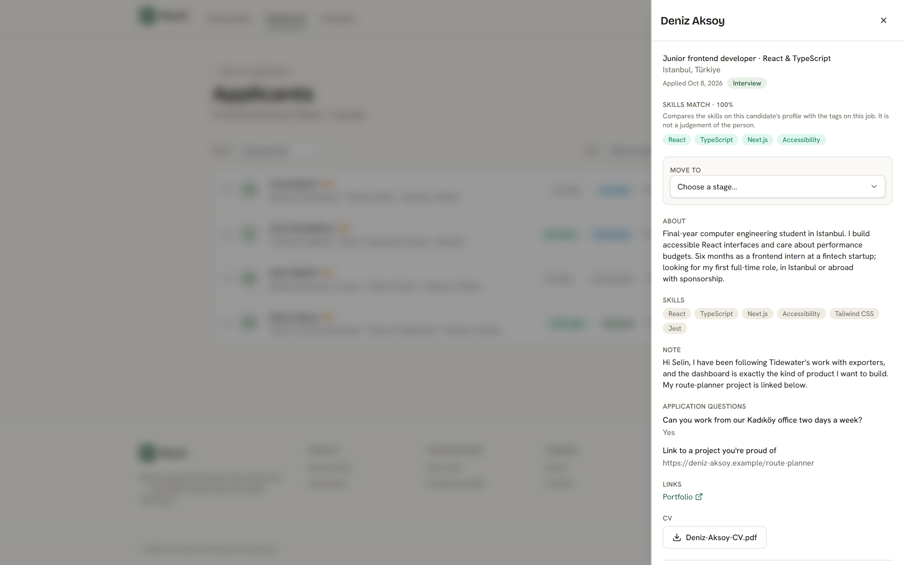
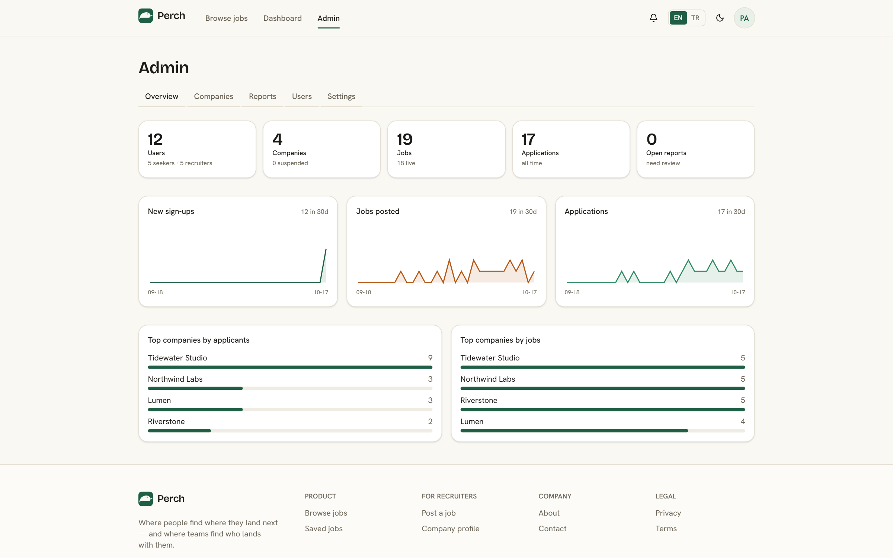
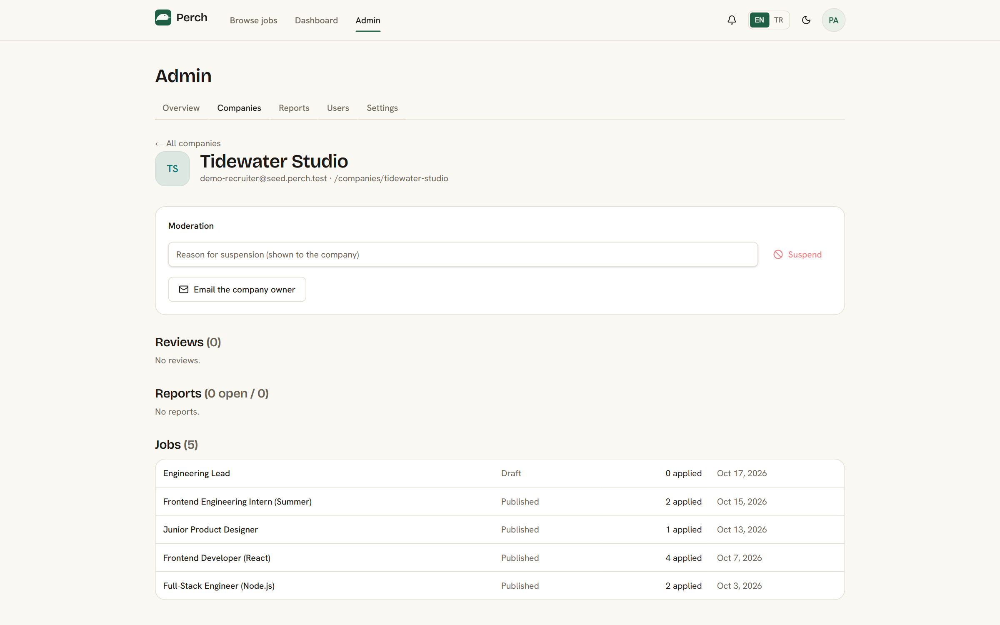

<p align="center">
  
</p>

<h1 align="center">Perch</h1>

<p align="center">A two-sided job board where people find where they land next — and where teams find who lands with them.</p>

<p align="center">
  
  
  
  
  
</p>

---

## Live demo

**[Open the live demo →](https://your-deployment.vercel.app/login)** &nbsp;·&nbsp; **[Demo video](https://your-video-link)**

<!-- Replace both links above once the deployment and the video are live. -->

No sign-up and nothing to type: on the sign-in page, under **Try the demo**,
pick a role. Each is a shared, ready-made account, and all demo data resets
every day.

| Role | Signed in as | Try this |
| --- | --- | --- |
| **Job seeker** | Deniz Aksoy, junior frontend developer in Istanbul | Six applications on the dashboard, from just submitted to an offer, with the employer's messages · a complete profile with CV, skills and job preferences · saved jobs and a job alert · an application to Tidewater's *Full-Stack Engineer (Node.js)* or *Junior Product Designer*, which ask the recruiter's own questions |
| **Recruiter** | Selin Arslan, owner of Tidewater Studio (verified) | The pipeline for *Frontend Developer (React)*: move a candidate, rate them, leave an internal note, download a CV · post a job or import a CSV · per-job analytics · the team page |

Demo accounts can do nearly everything a real one can. They cannot change
their password or email, delete themselves, send email or invitations, or
apply to and review real companies.

There is no demo admin: a shared admin login would hand moderation of the live
site to every visitor. The admin console is shown in screenshots instead.

<p align="center">
  
  
</p>
<p align="center">
  
  
</p>

---

## Why Perch

Most job boards stop at the listing. A candidate applies and hears nothing; a
recruiter gets a pile of applications and a spreadsheet to sort them in. Perch
covers what happens after someone presses Apply, on both sides.

- **Candidates know where they stand.** Every application shows its status and
  a timeline of what the employer did, and each company's response rate is
  public. Silence is visible.
- **Fit is shown, not guessed.** Jobs and profiles use the same terms — skills,
  experience, job type, work mode, location, work authorisation — so a match is
  laid out plainly, with matched and missing skills side by side. A field left
  blank is never counted against anyone.
- **Recruiters get real hiring tools.** A stage pipeline with notes and
  ratings, their own application questions and screening gates, team seats,
  per-job analytics and bulk CSV import: the parts of an applicant-tracking
  system a small team actually uses, in the same place the job is posted.
- **Private by default.** A seeker's profile is visible to the employers they
  apply to, and to recruiters only if they choose to be found. Exporting or
  deleting your data (KVKK / GDPR) is a button, not an email.
- **Built for two languages.** English and Turkish throughout, light and dark,
  on phone and desktop.

## Brand

The mark is a bird perched on a branch inside a rounded spruce square. A perch
is where you land, pause and look around before the next move — which is what a
job search actually is, and what the product is named for.

### Colour

Tokens are defined in `src/app/globals.css` as `:root` and `.dark`.

| Token | Light | Dark | Used for |
| --- | --- | --- | --- |
| `--background` |  `#faf8f3` |  `#14130f` | Page canvas |
| `--foreground` |  `#1b1a16` |  `#f2efe6` | Body text |
| `--card` |  `#ffffff` |  `#1c1a15` | Panels, job cards |
| `--muted` |  `#efece3` |  `#262218` | Secondary surfaces |
| `--muted-foreground` |  `#6b6557` |  `#a49b88` | Secondary text |
| `--border` |  `#e4dfd2` |  `#322d21` | Dividers, outlines |
| `--primary` |  `#1e5f45` |  `#4fb488` | Spruce green — primary actions |
| `--accent` |  `#e8f0e8` |  `#1e2a22` | Active nav, avatars |
| `--highlight` |  `#b45816` |  `#e0904c` | Warm rust — used sparingly |
| `--ring` |  `#2f8a63` |  `#4fb488` | Focus rings |

Corner radius is a single token, `--radius: 0.625rem`.

### Typography

Loaded in `src/app/layout.tsx`, all with the `latin-ext` subset so Turkish
`ğ ş ı İ` render in the real webfont rather than falling back mid-word.

| Face | Role |
| --- | --- |
| **Bricolage Grotesque** | Display headings. An editorial grotesque with an optical-size axis, so it redraws between phone and desktop rather than scaling one drawing up. |
| **Hanken Grotesk** | Body and UI. Humanist, open apertures, legible at the 14px of a job card. |
| **Geist Mono** | Code — the CSV import preview. |

The type scale is fluid: `--text-2xl` through `--text-7xl` are `clamp()` values
interpolating between a phone size and a desktop size, overridden in `@theme`
so every existing `text-4xl` became responsive without touching a component.

### Principles

From `docs/design-spec.md`:

1. **One hue, no rainbow gradients.** A single spruce wash (`.bg-editorial`)
   plus a film-grain overlay (`.grain`), never multi-colour mesh.
2. **Warm neutrals, not cold zinc.** Ivory and sand backgrounds.
3. **One design system everywhere.** Dashboards, admin and auth reuse the same
   `components/ui/*` kit as the public board, so recruiter and seeker surfaces
   feel like one product.
4. **Motion answers the user.** Hero motion is pointer-driven and disabled
   under `prefers-reduced-motion` and on coarse pointers.

## Features

### For job seekers

- Browse and filter by keyword, job type, work mode, experience, salary
  floor, posting language, entry-level roles and visa sponsorship.
- Job detail with a full description, custom application questions, and a
  **pay-in-context** panel showing how the salary compares with the board's own
  median for that level.
- Save jobs as a guest (localStorage) and have them merged into the account on
  sign-in.
- Apply on-site with an optional note, a CV attachment, and answers to the
  recruiter's custom questions. Screening gates tell you immediately if an
  answer makes you ineligible, instead of leaving you waiting.
- **Application tracking** — every application shows its status, and the
  timeline records what the employer did and when.
- Profile with headline, bio, links, CV upload, and **skills autocomplete**
  drawn from the tags employers on this board actually use, including
  did-you-mean corrections.
- **Matching fields** — experience level, work authorisation, and desired job
  types, work modes and locations.
- A profile-strength meter that names the next most valuable thing to add.
- **AI fit score** per job, cached per (seeker, job) and capped per seeker per
  day; degrades silently when no API key is configured.
- **Job alerts** — save a search, choose daily or weekly, receive one grouped
  digest rather than one email per alert.
- `/salaries` — public median and quartile pay by experience level.
- **Export or delete your data** (KVKK / GDPR), as buttons, without emailing
  anyone.

### For recruiters

- Company profile with logo upload and a public page.
- Post, draft, edit, close and duplicate jobs; **bulk CSV import** with a
  preview that reports bad rows by spreadsheet line number.
- Up to six custom application questions per job, any of which can be a
  screening gate.
- Applicant list with stage filtering, bulk stage moves, a 1–5 private rating,
  internal notes, full history, and short-lived signed-URL CV downloads.
- A **transparent skills match** per applicant — deterministic overlap against
  the job's tags, always shown with the matched and missing skills beside it,
  never an opaque score.
- Email on each new applicant, and templated candidate messages for every stage
  including four rejection templates.
- **Team seats** — invite colleagues as admin or recruiter, transfer ownership.
- **Hiring analytics** — views, apply rate, reply rate and median
  time-to-first-response per job.
- Company reviews from seekers, with a public response-rate badge.

### For admins

Moderation of jobs, users, companies and reports; a settings panel; per-user
detail views; and an append-only audit log.

### Platform

English and Turkish, light and dark themes, SEO metadata with `sitemap.xml`,
`robots.txt` and schema.org `JobPosting` structured data, baseline security
headers on every route, Postgres-backed rate limiting, row-level security on
all 20 tables, seeker-profile privacy (`0021`), a health endpoint plus three
Vercel cron jobs, and an optional portfolio demo mode.

## Product tour

| Area | Route | What it is |
| --- | --- | --- |
| Public | `/` | Landing page with live counts and search |
| | `/jobs` | Browse and filter |
| | `/jobs/[slug]` | Job detail, apply, pay context |
| | `/companies/[slug]` | Company profile, reviews, open roles |
| | `/salaries` | Median and quartile pay by level |
| | `/login`, `/signup`, `/onboarding` | Auth and role choice |
| Seeker | `/dashboard` | Applications with employer status |
| | `/profile` | Profile, skills, matching fields, data controls |
| | `/saved-jobs` | Shortlist |
| | `/alerts` | Saved searches and digest frequency |
| Shared | `/notifications` | In-app notification centre |
| | `/join` | Accept a team invitation |
| Recruiter | `/dashboard` | Own jobs by status with applicant counts |
| | `/dashboard/jobs/new`, `/dashboard/jobs/import` | Post one job or import many |
| | `/dashboard/jobs/[id]/applicants` | Pipeline, notes, CV download |
| | `/dashboard/analytics` | Per-job funnel |
| | `/company`, `/company/team` | Company profile and seats |
| Admin | `/admin` and `/admin/{users,companies,reports,settings}` | Moderation |
| API | `GET /api/jobs`, `GET /api/jobs/[slug]` | Public JSON |
| | `GET /api/health` | Weekly keep-alive cron |
| | `GET /api/alerts/run` | Daily alert digest cron (`CRON_SECRET`) |
| | `GET /api/cron/demo-reset` | Daily demo reset, demo mode only (`CRON_SECRET`) |

## Tech stack and architecture

Next.js 16 App Router, React 19, TypeScript, Tailwind CSS v4, Supabase
(Postgres, Auth, Storage, RLS) via `@supabase/ssr`, React Hook Form with Zod,
Resend for transactional email, the Anthropic Messages API for fit scores,
Vitest for all three test tiers.

Code is organised by feature, not by layer. Route files under `src/app` stay
thin; everything reusable lives in `src/features/*` with its own `data.ts`
(reads), `actions.ts` (writes), `schema.ts` (Zod) and `components/`.

**RLS is the authorisation boundary.** Application code gates the UI and
redirects, but the database decides. Three security-definer helpers —
`owns_company()`, `owns_job()` and `owns_application()` — are consulted by
almost every policy, which is why adding company team seats in `0018` could
make the whole app team-aware by redefining those three functions rather than
editing thirty policies.

### Security

Reviewed against the OWASP Top 10 (2021). All 20 tables have RLS enabled; the
service-role key is confined to modules marked `server-only`; every server
action is gated by a session check and validates its input; redirect
parameters are filtered through `safeRelativePath`; outbound requests go only
to two fixed hosts; rate limits are enforced in Postgres rather than in process
memory. Structured data embedded in a `<script>` tag is escaped so
recruiter-authored job text cannot break out of it.

Demo mode is built on the assumption that everyone on the internet shares the
demo logins. Their passwords never leave the server; the actions that would
let one visitor lock out the next, or reach a real person, are refused on the
server; a database trigger (`0023`) keeps their email addresses fixed even
against direct Auth API calls; and demo and real accounts cannot apply to or
review each other's companies.

## Getting started

**Prerequisites:** Node 20+, npm, a Supabase project, and the Supabase CLI for
migrations.

```bash
npm install
cp .env.example .env.local     # then fill it in
npx supabase link --project-ref <your-ref>
npm run db:push                # apply migrations
npm run db:types               # regenerate database types
npm run seed                   # demo companies, jobs and accounts
npm run dev                    # http://localhost:3000
```

`npm run seed:clear` removes every seeded account and everything attached to
it; `npm run demo:reset` does both, which is what the daily cron runs in demo
mode.

On Windows, run the Supabase CLI from PowerShell — the Go binary misbehaves
under Git Bash.

### Environment

| Variable | Required | Purpose |
| --- | --- | --- |
| `NEXT_PUBLIC_SUPABASE_URL` | Yes | Supabase project URL |
| `NEXT_PUBLIC_SUPABASE_ANON_KEY` | Yes | Public client key, guarded by RLS |
| `SUPABASE_SERVICE_ROLE_KEY` | Yes | Server-only; bypasses RLS. Never exposed to the client |
| `SUPABASE_DB_PASSWORD` | Yes | Used by the CLI for migrations |
| `NEXT_PUBLIC_SITE_URL` | Yes | Canonical origin for OAuth redirects, emails and SEO |
| `RESEND_API_KEY` | Optional | Transactional email. Without it, mail is logged and skipped |
| `EMAIL_FROM` | Optional | Sender identity for Resend |
| `ANTHROPIC_API_KEY` | Optional | AI fit score. Without it, seekers simply do not see a score |
| `CRON_SECRET` | Production | Shared secret for the alert and demo-reset crons. Without it both refuse to run |
| `SEED_ADMIN_EMAIL` | Optional | Address added to `admin_emails` by the seed script. Never a demo address |
| `NEXT_PUBLIC_DEMO_MODE` | Optional | `true` turns on one-click demo sign-in, the demo banner and the daily reset. Inlined at build time |
| `DEMO_SEEKER_PASSWORD` | Demo mode | Password for the shared demo seeker. Server-only, read by the sign-in action |
| `DEMO_RECRUITER_PASSWORD` | Demo mode | Password for the shared demo recruiter. Server-only, read by the sign-in action |

## Database and migrations

| # | Purpose |
| --- | --- |
| `0001` | Core schema, RLS enabled, `is_admin()` / `owns_job()` helpers |
| `0002` | Auth-facing RLS for profiles, companies, seeker profiles |
| `0003` | Role immutability trigger |
| `0004` | Job write policies, `owns_company()` |
| `0005` | Application policies; submitted applications are immutable |
| `0006` | Saved-jobs policies |
| `0007` | Admin console v2, reports, audit log |
| `0008` | Restore the jobs insert policy |
| `0009` | Company reviews and apply-method tracking |
| `0010` | Entry-level and visa-sponsorship flags on jobs; fit-score cache |
| `0011` | Per-job custom application questions |
| `0012` | Content language on jobs and companies |
| `0013` | Fit-score `updated_at` |
| `0014` | Admin-role hardening, CV retention, fit-score writes |
| `0015` | Hiring pipeline, append-only application events |
| `0016` | Postgres-backed rate limiting |
| `0017` | Saved searches, job alerts, notifications |
| `0018` | Company team seats; ownership helpers become membership-based |
| `0019` | Job view counters and a per-team totals view |
| `0020` | Screening gates on application questions |
| `0021` | Featured listings, verified employers, opt-in sourcing — and the fix that replaced the world-readable `seeker_profiles` policy |
| `0022` | Seeker matching fields: work authorisation, experience, preferences |
| `0023` | Demo-account guards: seed-domain emails are frozen and can never be admins |

## Testing

| Command | Covers |
| --- | --- |
| `npm run typecheck` | `next typegen` then `tsc --noEmit` |
| `npm run lint` | ESLint, including the React Compiler rules |
| `npm run test:unit` | Pure logic — matching, scheduling, CSV parsing, salary maths, linting rules. No database |
| `npm run test:integration` | RLS policies and SQL functions against a real Supabase project |
| `npm run test:e2e` | Server actions end to end, serially |
| `npm run test:all` | All three tiers |
| `npm run build` | Production build |

Integration and e2e tests create and delete real rows, so point them at a
scratch project, not production.

## Deployment

Vercel, auto-deploying from `main`, with Supabase as the backend and three cron
jobs declared in `vercel.json`. Full steps in
[`docs/DEPLOYMENT.md`](docs/DEPLOYMENT.md).

## Roadmap

Noted in `docs/design-spec.md` as explicit v1 non-goals that remain open:
in-app messaging between recruiter and candidate, multiple companies per
recruiter, structured work history and a résumé builder, and public candidate
search beyond the opt-in sourcing view.

## Status

Private project. All rights reserved. No licence is granted.
